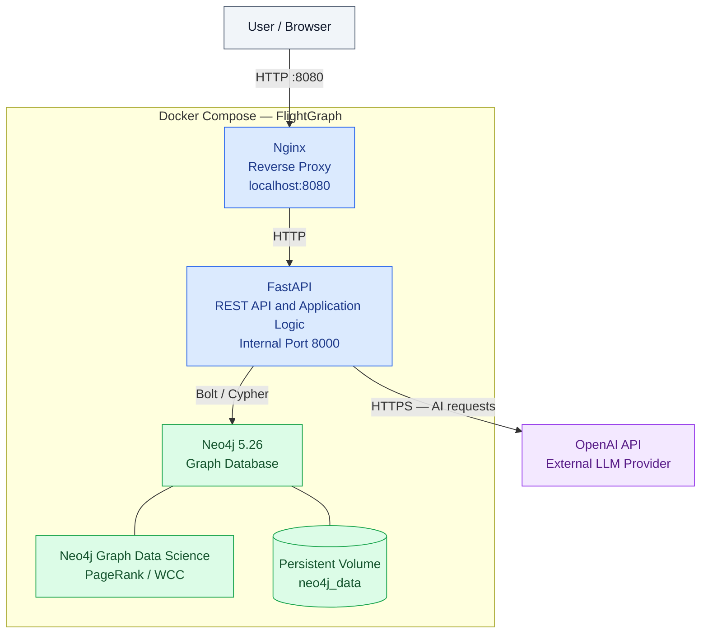
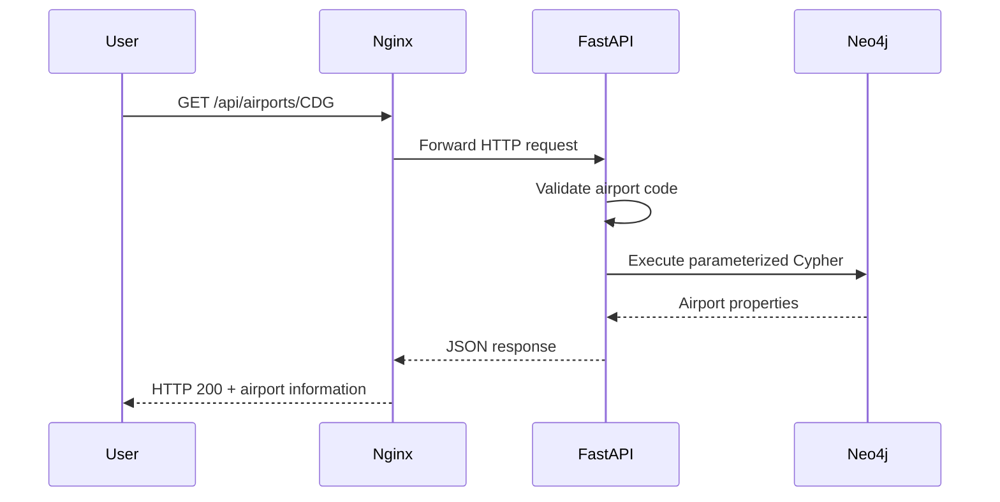
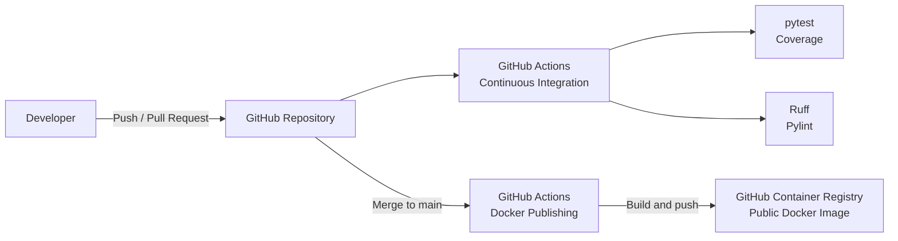

# FlightGraph — Software Architecture

## Overview

FlightGraph is a graph-based application for analyzing airline
network connectivity and simulating airport disruptions.

The architecture separates HTTP request handling, application logic,
graph data storage, AI integration, and development infrastructure.

The application uses three Docker Compose services:

1. Nginx
2. FastAPI
3. Neo4j

An external OpenAI API provides language-model functionality
for the AI assistant.

## System Architecture Diagram



**Note:** Neo4j Graph Data Science is a plugin running inside Neo4j,
not a separate Docker container.

The OpenAI API is an external service and is not part of Docker Compose.

## Runtime Components

### 1. Nginx — Reverse Proxy

Nginx is the entry point for HTTP requests.

It listens on:

```text
http://localhost:8080
```

Incoming requests are forwarded to FastAPI through Docker's
internal network.

For example:

```text
Browser
   |
   v
Nginx :8080
   |
   v
FastAPI :8000
```

Nginx separates the client-facing HTTP entry point from
the application server.

The local configuration uses HTTP and does not provide
production-grade HTTPS termination or authentication.

### 2. FastAPI — Application Backend

FastAPI implements the REST API and application logic.

Its responsibilities include:

- Validating requests with Pydantic.
- Retrieving airport information.
- Exploring direct and multi-hop connections.
- Finding shortest routes.
- Executing disruption simulations.
- Processing AI-assisted questions.
- Returning structured JSON responses.
- Handling supported application errors.

FastAPI communicates with Neo4j through the Bolt protocol.

Inside Docker Compose, the connection uses:

```text
bolt://neo4j:7687
```

Docker's internal DNS resolves `neo4j` to the database service.

### 3. Neo4j — Graph Database

Neo4j stores the historical airline network.

The implemented graph contains:

- `Airport` nodes.
- `Airline` nodes.
- `Country` nodes.
- Directed `FLIES_TO` relationships.
- `LOCATED_IN` relationships.
- `OPERATES` relationships.

Neo4j supports graph traversal using Cypher.

Its persistent data is stored in the Docker volume:

```text
neo4j_data
```

This allows data to survive normal container restarts
and recreation.

### 4. Neo4j Graph Data Science

Neo4j Graph Data Science (GDS) runs as a Neo4j plugin.

FlightGraph uses GDS for:

- PageRank.
- Weakly Connected Components.
- Graph connectivity analysis.
- Single-airport closure simulations.

GDS algorithms operate on graph projections maintained
in Neo4j memory.

Temporary projections created during simulations are
deleted after the simulation.

### 5. OpenAI API — AI Integration

FlightGraph includes an AI assistant that interprets
natural-language questions about the airline network.

The assistant uses an external language model to classify
requests into approved graph operations.

The application validates these operations before executing
predefined Neo4j queries.

The assistant does not execute unrestricted
LLM-generated Cypher queries.

An OpenAI API key is required for AI assistant requests.

Core graph exploration and disruption simulation do not
require access to the OpenAI API.

---

## Request Flow

The following example shows how FlightGraph retrieves an airport.



The request proceeds through four steps:

1. The user sends an HTTP request through Nginx.
2. FastAPI validates the request.
3. Neo4j executes the relevant Cypher query.
4. FastAPI returns structured JSON through Nginx.

---

## Container Health Checks

Docker Compose defines health checks for all three services.

| Service | Health check |
| --- | --- |
| Neo4j | Execute a simple Cypher query |
| FastAPI | Request `/health` |
| Nginx | Request `/health` through the reverse proxy |

The services use health-based startup dependencies.

Neo4j must become healthy before FastAPI starts.

FastAPI must become healthy before Nginx starts.

These checks improve startup reliability but do not guarantee
that every application feature or external service is available.

---

## Development and CI/CD Architecture

FlightGraph also includes automated development tooling.



### Continuous Integration

GitHub Actions verifies code changes before they are
merged into the stable `main` branch.

The CI workflow executes:

- pytest.
- Coverage checks (minimum 60%).
- Ruff.
- Pylint (minimum 9.5/10).

### Container Publishing

A separate GitHub Actions workflow builds and publishes
the FastAPI Docker image to GitHub Container Registry.

Published image:

```text
ghcr.io/camille-tanguy/flightgraph-api:latest
```

Supported platforms:

- `linux/amd64`
- `linux/arm64`

The published image contains the FastAPI backend.

The complete application is started through Docker Compose.

---

## Architectural Decisions

### Why Neo4j?

FlightGraph focuses on relationships between airports.

Neo4j supports graph-oriented queries, multi-hop traversal,
pathfinding, and graph analytics without requiring
complex relational joins.

### Why FastAPI?

FastAPI provides:

- Request validation using Pydantic.
- Automatic OpenAPI documentation.
- Structured JSON responses.
- A lightweight Python backend.

This is appropriate for a solo project without requiring
a sophisticated frontend.

### Why Docker Compose?

Docker Compose defines and manages the application's
three services in a reproducible configuration.

It provides:

- Service networking.
- Container startup management.
- Health checks.
- Persistent database storage.

### Why Nginx?

Nginx provides a separate HTTP entry point for the application.

This satisfies the reverse-proxy requirement while keeping
FastAPI internal to the Docker network.

### Why a Restricted AI Assistant?

Allowing unrestricted LLM-generated Cypher queries would
introduce security and reliability risks.

FlightGraph instead maps natural-language requests to
validated, predefined database operations.

This favors predictable behavior and safer database access
over unrestricted query flexibility.

---

## Limitations

- The local deployment uses HTTP rather than HTTPS.
- No production authentication layer is implemented.
- The application relies on historical OpenFlights data.
- Neo4j Graph Data Science projections consume memory.
- The AI assistant depends on an external API provider.
- The system is designed for educational analysis
  rather than production airline operations.
