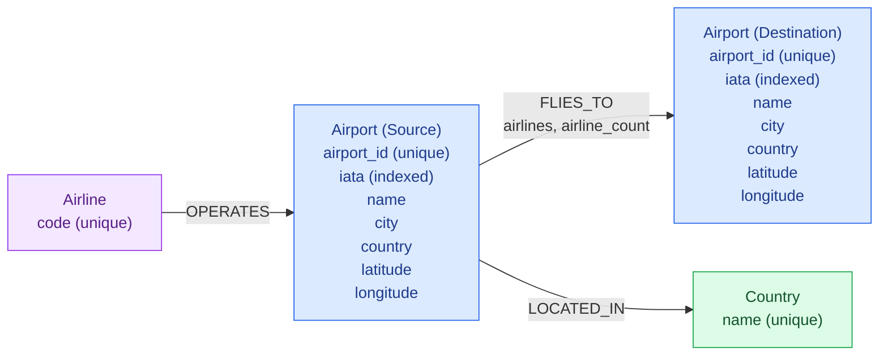

# FlightGraph — Graph Database Schema

## Overview

FlightGraph uses Neo4j to represent the historical OpenFlights airline network.

The graph contains three node labels and three relationship types.

The model prioritizes efficient airport-to-airport traversal, graph analytics,
and airport disruption simulation.

## Graph Schema Diagram



**Note:** Source and destination airports are instances of the same
`Airport` node label, not two different node types.

## Node Labels

| Label | Properties | Unique identifier |
| --- | --- | --- |
| `Airport` | `airport_id`, `name`, `city`, `country`, `iata`, `latitude`, `longitude` | `airport_id` |
| `Airline` | `code` | `code` |
| `Country` | `name` | `name` |

## Relationship Types

| Relationship | Direction | Description |
| --- | --- | --- |
| `FLIES_TO` | Airport → Airport | Historical directed airport connection |
| `LOCATED_IN` | Airport → Country | Airport geographical location |
| `OPERATES` | Airline → Airport | Airline serves an airport |

The `FLIES_TO` relationship also contains:

- `airlines`: List of airline codes associated with the connection.
- `airline_count`: Number of distinct airlines serving the connection.

## Modeling Decisions

### 1. Direct Airport-to-Airport Connections

FlightGraph represents historical routes using directed `FLIES_TO`
relationships between airports.

For example:

```cypher
MATCH (source:Airport)-[:FLIES_TO]->(destination:Airport)
RETURN source.iata, destination.iata
LIMIT 10;
```

This representation supports:

- Direct flight connection exploration.
- Multi-hop reachability.
- Shortest-path queries.
- PageRank and connectivity analysis.
- Airport closure simulations.

A separate `Route` node could provide greater modeling flexibility,
but would introduce additional relationships and traversal complexity.

Since FlightGraph focuses primarily on network connectivity,
direct airport-to-airport relationships are appropriate.

### 2. Aggregated Airline Information

Multiple airlines may operate the same airport connection.

Instead of creating separate route nodes for every airline,
FlightGraph aggregates airline information on each `FLIES_TO`
relationship.

For example:

```text
(Airport A)-[:FLIES_TO {
    airlines: ["AF", "DL"],
    airline_count: 2
}]->(Airport B)
```

This representation reduces graph complexity and supports efficient
airport-to-airport traversals.

However, it sacrifices some flexibility: airline-specific route
analysis requires inspecting relationship properties rather than
traversing separate route entities.

This trade-off is appropriate because FlightGraph primarily focuses
on network connectivity and disruption analysis.

### 3. Countries

Each airport is connected to its country through `LOCATED_IN`.

```text
(Airport)-[:LOCATED_IN]->(Country)
```

Country nodes allow airports to share a geographical entity rather
than creating duplicate country nodes for every airport.

### 4. Airlines

Each airline is connected to the airports it serves.

```text
(Airline)-[:OPERATES]->(Airport)
```

The `OPERATES` relationship represents airport service coverage,
not individual flights or particular flight directions.

## Constraints and Indexes

FlightGraph defines the following database constraints and indexes:

| Name | Label | Property | Type |
| --- | --- | --- | --- |
| `airport_id_unique` | Airport | `airport_id` | Uniqueness constraint |
| `airline_code_unique` | Airline | `code` | Uniqueness constraint |
| `country_name_unique` | Country | `name` | Uniqueness constraint |
| `airport_iata_index` | Airport | `iata` | Range index |

Airport identifiers are unique.

IATA codes are indexed for efficient searches but are not guaranteed
to be unique in the original dataset.

The airport IATA index was confirmed to be used by Neo4j's query planner.

See [Query Optimization](query-optimization.md) for execution-plan
measurements using `EXPLAIN` and `PROFILE`.

## Graph Analytics Projection

FlightGraph uses an airport-to-airport graph projection for
Neo4j Graph Data Science algorithms.

The validated projection contains:

- **7,698 airports**
- **36,906 directed airport-to-airport connections**

This projection focuses on the `Airport` nodes and `FLIES_TO`
relationships rather than every label and relationship in the database.

It supports PageRank, Weakly Connected Components,
and airport disruption simulations.

## Limitations

- OpenFlights contains historical routes rather than live schedules.
- `FLIES_TO` relationships represent directed airport pairs,
  not individual flights.
- Routes do not include departure times, prices, or flight frequencies.
- Airline information is aggregated at the route level.
- `OPERATES` does not describe individual flights.
- IATA codes are not guaranteed to be unique.
- The graph model represents network structure rather than
  real-world airline operational constraints.
